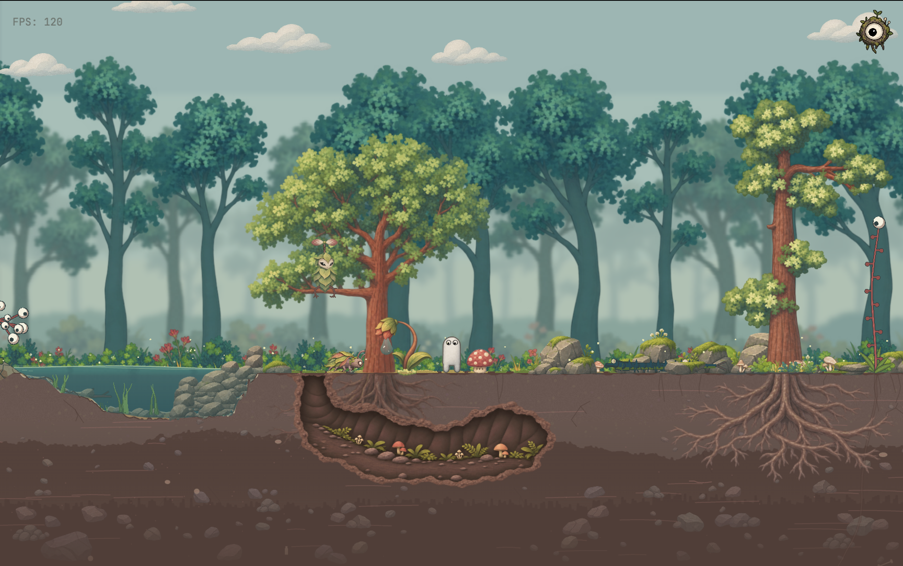

# rootward

A quiet 2D platformer about going down to face your fear.

**[Play online](https://find-myself.netlify.app/)**



## Concept

The hero goes deeper and deeper, level by level, toward the fear he wants to overcome.
The closer he gets, the more dangerous the world becomes, and he does not notice how near he already is.

Every level is a small ecosystem. Understand how it lives, then use it to move on.

## Levels

The game has four levels, each one deeper than the last:

1. **Forest** — the surface: water, apples, a burrowing apple-eater and plants that watch you.
2. **Cave** — underground: glowing mushrooms, roots and things living in the dark.
3. In development.
4. In development.

## Development

```sh
npm install      # install dependencies
npm run dev      # dev server at http://localhost:3001
npm run build    # production build into dist/
npm run zip      # build and zip
npm run bin      # desktop binary for the current OS
```

Built with JavaScript, [Kaplay](https://kaplayjs.com/) and Vite.

## License

MIT — see [LICENSE](LICENSE).
